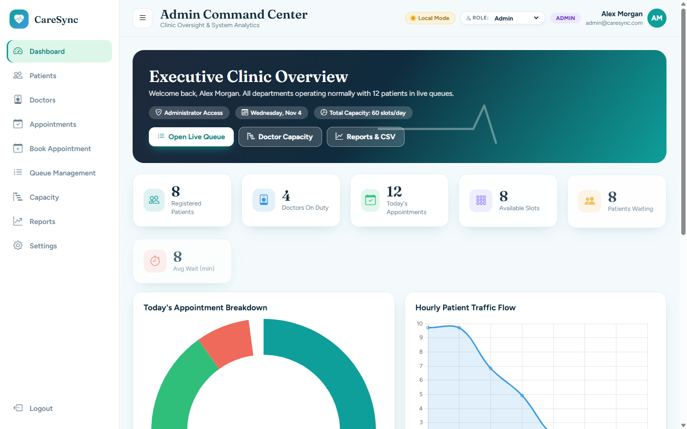
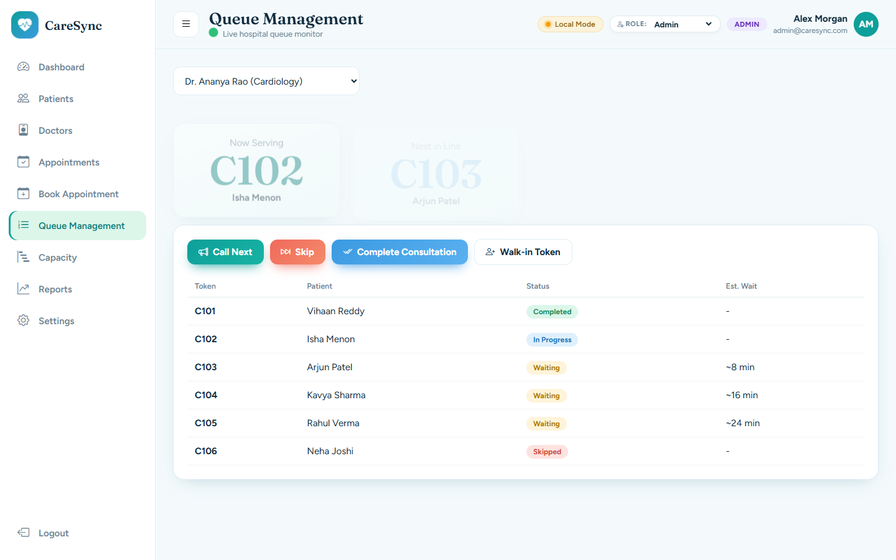
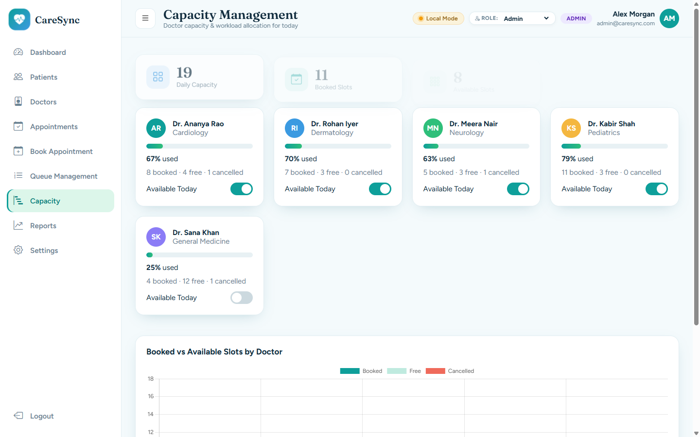
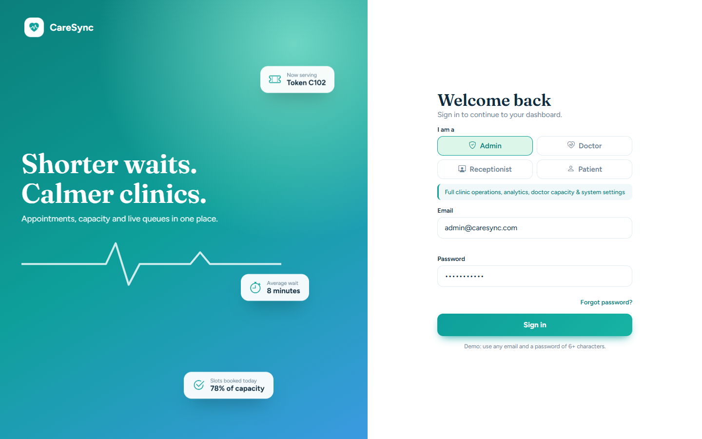

# 🏥 CareSync

> **Shorter waits. Calmer clinics.**  
> An integrated healthcare appointment booking, doctor capacity planning, and live queue management system.

---

## 📸 Screenshots & Previews

### 📊 Admin Command Center
Full clinic oversight, patient traffic flow, department workload, and executive analytics.


---

### 🎟️ Real-Time Queue Management & Token System
Live token tracker with instant status updates, walk-in token generation, and consultation controls.


---

### 👨‍⚕️ Doctor Capacity & Workload Allocation
Track booked vs. available slots by doctor and department with automatic availability toggles.


---

### 🔐 Multi-Role Authentication
Role-tailored interfaces and permissions for **Admin**, **Doctor**, **Receptionist**, and **Patient**.


---

## 🌟 Key Features

- **Multi-Role Portals**:
  - **Admin**: Executive clinic overview, real-time analytics, capacity planning, and system configurations.
  - **Doctor**: Consultation console, personal patient queue, vitals tracking, and follow-up booking.
  - **Receptionist**: Front desk intake, instant walk-in token issuance, and patient check-ins.
  - **Patient**: Personal health portal, live token tracker with estimated wait times, and appointment scheduling.
- **Dynamic Token & Live Queue Engine**: Automatic token generation (e.g., `C101`, `C102`), consultation timers, and queue status transitions (*Waiting*, *In Progress*, *Completed*, *Skipped*).
- **Interactive Analytics**: Dynamic Chart.js visualizations for appointment status breakdown and hourly patient traffic flow.
- **Offline / Local Mode Support**: Built-in mock data engine using browser `localStorage` allows instant demo usage without mandatory database configuration.
- **Full Backend Support**:
  - **Node.js**: Express server with MySQL connection pooling and RESTful API endpoints.
  - **Java Backend**: Standard Java HTTP server (`CareSyncServer`) with JDBC connectivity.

---

## 📁 Project Structure

```text
caresync/
├── screenshots/                  # Project screenshots for documentation
│   ├── dashboard.png
│   ├── queue.png
│   ├── capacity.png
│   └── login.png
├── caresync/                     # Web Application
│   ├── css/
│   │   └── style.css             # Unified modern clinical UI stylesheet
│   ├── js/
│   │   ├── app.js                # Role navigation, rendering, and UI logic
│   │   ├── data.js               # Demo dataset & localStorage state management
│   │   └── login.js              # Authentication and role switcher
│   ├── java-backend/             # Optional Java backend
│   │   ├── pom.xml
│   │   └── src/com/caresync/
│   │       ├── CareSyncServer.java
│   │       └── DBConnection.java
│   ├── index.html                # Sign-in portal
│   ├── dashboard.html            # Main clinic dashboard
│   ├── queue.html                # Live queue & token tracker
│   ├── appointments.html         # Appointments management
│   ├── book.html                 # Book appointment / walk-in
│   ├── capacity.html             # Doctor workload and capacity
│   ├── patients.html             # Patient records registry
│   ├── doctors.html              # Doctor directory & profiles
│   ├── reports.html              # Clinic reports & analytics
│   ├── settings.html             # System configuration
│   └── server.js                 # Express server & API endpoints
├── server.js                     # Root entry point
├── package.json                  # Node.js dependencies
└── README.md                     # Project documentation
```

---

## 🚀 Getting Started

### 1. Instant Preview (Frontend Standalone)
You can test the frontend immediately without setting up a backend or database:
1. Open [`caresync/index.html`](caresync/index.html) in any modern browser.
2. Select any role (**Admin**, **Doctor**, **Receptionist**, or **Patient**).
3. The demo credentials are auto-filled—click **Sign in** to enter the portal.

---

### 2. Node.js Backend (Optional)
To run the Node.js API server:

```bash
# Install dependencies
npm install

# Start the server
npm start
```
The server will start on `http://localhost:3000`.

---

### 3. Java Backend (Optional)
To run the standalone Java HTTP server:

```bash
cd caresync/java-backend
javac -d bin src/com/caresync/*.java
java -cp bin com.caresync.CareSyncServer
```

---

## 🛠️ Built With

- **Frontend**: HTML5, Modern CSS3, JavaScript (ES6+), [Chart.js](https://www.chartjs.org/), [Bootstrap Icons](https://icons.getbootstrap.com/)
- **Backend**: Node.js, Express, MySQL2
- **Java**: Java SE, Embedded HttpServer, JDBC

---

## 📄 License
This project is open source and available under the [MIT License](LICENSE).
